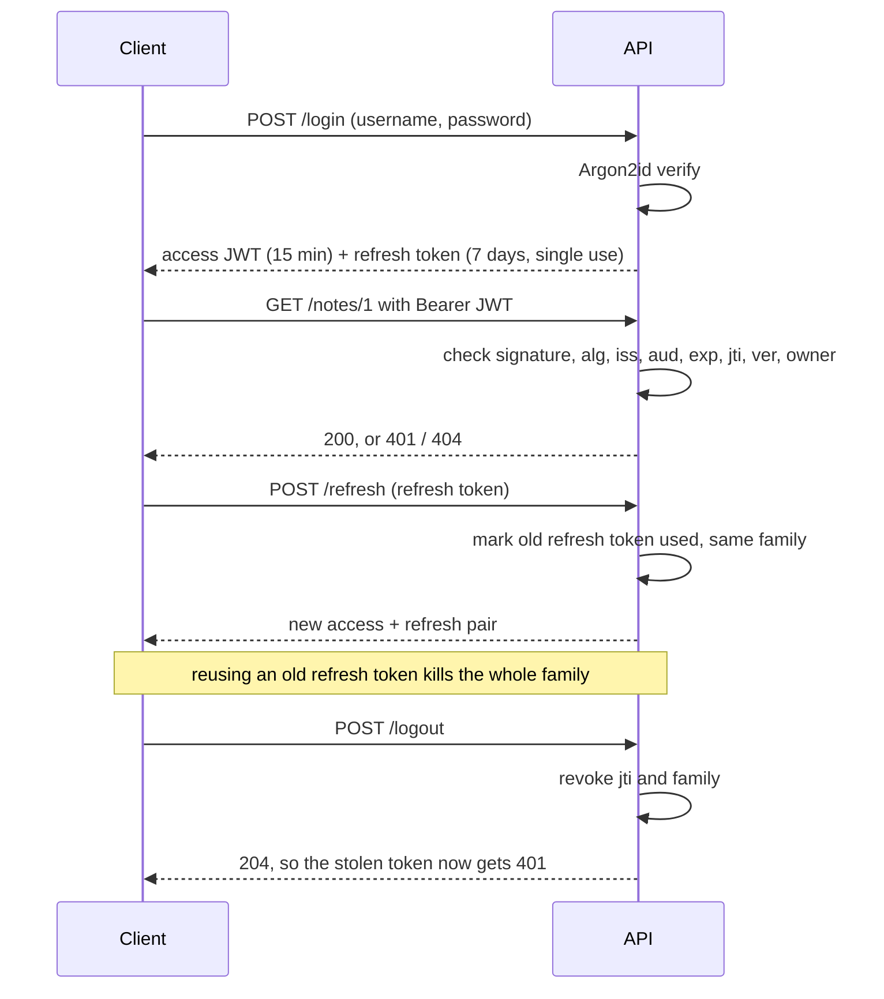

# jwt-auth-lab

**Author:** Asad Ali Hassan, DevSecOps Engineer ([GitHub](https://github.com/asadyare))

A small FastAPI login service that I built, attacked and then hardened, as Stage 2 (Identity) of my hands-on security roadmap. It shows how JWT authentication fails in real apps and how to prove that the fixes hold, using automated security tests that run in CI on every push.

> This is a learning lab. All attacks were run against my own code on my own machine.

## What it does

| Endpoint | Purpose | Protection |
|---|---|---|
| `POST /register` | Create a user | Password hashed with Argon2id |
| `POST /login` | Get an access token and a refresh token | Same response and same hashing work for a wrong password and an unknown user |
| `GET /me` | Who am I | Valid signed JWT required |
| `POST /notes`, `GET /notes/{id}` | Private notes | Ownership check, so other users get 404 (stops BOLA, broken object-level authorisation) |
| `GET /admin/users` | List users | Admin role required (stops BFLA, broken function-level authorisation) |
| `POST /refresh` | Swap a refresh token for a new pair | Single-use rotation with reuse detection |
| `POST /logout` | End this session | Revokes the token's `jti` and its refresh family |
| `POST /logout-all` | End every session | Bumps the user's token version |

## How the tokens work



Access tokens are HS256 JWTs with `sub`, `role`, `iss`, `aud`, `iat`, `exp`, `jti`, `ver` and `fam` claims. The server only accepts `HS256` and requires every claim. Refresh tokens are random strings, and only their SHA-256 hash is stored.

## Attacks I ran and how I fixed them

| Attack | What went wrong first | Fix | Test that proves it |
|---|---|---|---|
| Tampered payload (role changed to admin) | Unverified tokens would let anyone become admin | Signature verified with a secret from the environment | `test_bad_tokens_rejected`, `test_role_claim_cannot_be_self_promoted` |
| `alg: none` token | Unsigned token accepted by naive code | `algorithms=["HS256"]` pinned | `test_bad_tokens_rejected` |
| Wrong issuer, audience or expired token | Token from elsewhere or too old | `iss`, `aud`, `exp` enforced and required | `test_bad_tokens_rejected` |
| Reading another user's note (BOLA) | Any logged-in user could read any note | Owner check, 404 so IDs aren't confirmed | `test_bola_other_users_note_hidden` |
| Normal user calls admin endpoint (BFLA) | Role not checked | 403 unless `role == admin` | `test_bfla_user_cannot_list_users` |
| Username enumeration | Different response or timing for unknown users | Same message, and a dummy Argon2 hash so timing matches | `test_wrong_password_and_unknown_user_look_the_same` |
| Stolen token after logout | JWTs stay valid until `exp` | `jti` deny-list on logout | `test_stolen_token_dies_after_logout` |
| Stolen token on another device | One logout doesn't end other sessions | `ver` claim and `/logout-all` | `test_logout_all_kills_other_sessions` |
| Stolen refresh token | Refresh tokens are long-lived | Rotation, and reuse revokes the family and all access tokens | `test_refresh_rotates_and_is_single_use`, `test_refresh_reuse_kills_family_and_access_tokens` |

### OAuth 2.0, OIDC and MFA (Lab 7)

Against a local Keycloak 26 realm, I ran the authorisation code flow with PKCE (S256), state and nonce checks.

| Test | Result |
|---|---|
| Replaying a used code | 400 "Code not valid" |
| Wrong PKCE verifier | 400 "PKCE verification failed" |
| Unregistered redirect URI | Rejected |

After turning on MFA, a token stolen *after* login still worked. MFA protects the login, not the token. Ending the session server-side is what killed it: refresh got 400 "Session not active" and userinfo got 401.

## Proving the fixes: security tests

`tests/test_security.py` has 22 pytest cases. Most check that an attack **fails**, because a broken control never breaks the happy path. Each run makes its own random `JWT_SECRET`, so no real secret is needed in CI.

To check the tests themselves, I removed a fix on purpose and confirmed the right test failed:

| Fix removed | Test that failed |
|---|---|
| Ownership check in `read_note` | `test_bola_other_users_note_hidden` (Bob got 200 instead of 404) |
| `jti` revocation in `logout` | `test_stolen_token_dies_after_logout` (200 instead of 401) |

Final result: `22 passed` (see `evidence/08-tests.txt`).

## Run it

```bash
python -m venv .venv && source .venv/bin/activate
pip install -r requirements.txt
cp .env.example .env        # then set your own JWT_SECRET and ADMIN_PASSWORD
uvicorn app.main:app --reload
python -m pytest -q
```

## CI and supply chain

`.github/workflows/tests.yml` runs on every push and pull request with read-only permissions. It runs the security tests and `pip-audit` for known vulnerable dependencies. It should be a required check, so a failing test blocks the merge.

Secrets stay out of Git: `.env` is in `.gitignore`. A gitleaks scan of the working folder found only the two values in the ignored `.env`, and a scan of the Git history found no leaks.

## Known limits

- The revocation list and refresh store live in memory. A restart brings revoked tokens back until they expire, and several app instances wouldn't share them. Production would use Redis or a database.
- Timing is only partly covered: the dummy hash evens out login timing, but the tests don't measure it.
- HS256 uses one shared secret. With several services, RS256 or ES256 with a key-rotation plan would be safer.
- There's no rate limiting on `/login`, so brute force is only slowed by Argon2.

## Repo layout

```
app/        FastAPI service
tests/      pytest security tests
notes/      my lab write-ups
evidence/   test and scan output (no secrets)
scripts/    lab helper scripts used during the attacks
.github/    CI workflow
```
