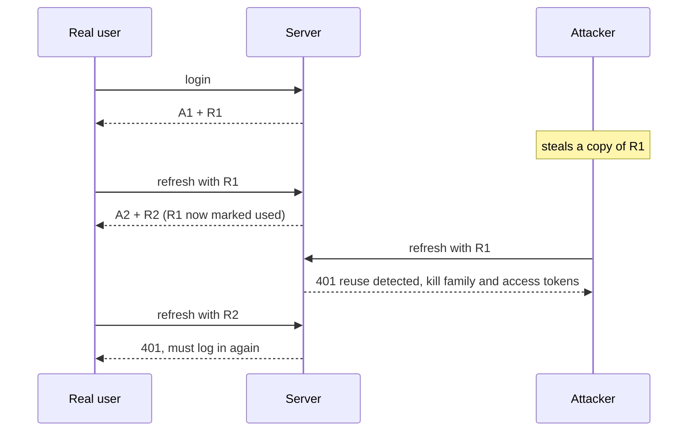

# Lab 6 — Session Hardening: Revocation, Login Timing and Refresh Tokens

## 1. Objective

Close the two gaps left by Labs 3 and 5:

1. A stolen access token kept working until it expired, even after logout and a server restart.
2. Login answered faster for unknown usernames, which leaked which accounts exist.

Part B then adds refresh tokens with rotation and reuse detection (section 7).

## 2. What I changed

`lab6_patch.py` changes `app/main.py` in one all-or-nothing step:

| Change | Why |
|---|---|
| Every token gets a unique `jti` and a `ver` (token version) claim, both required on verification | Lets the server identify and revoke individual tokens or all of a user's tokens |
| `revoked_jtis` store, checked on every request | A revoked token is rejected even though its signature is valid |
| `POST /logout` | Revokes only the token used for the request |
| `POST /logout-all` | Bumps the user's `token_version`, which kills every older token at once |
| Token rejected if its user no longer exists | A deleted account's tokens stop working |
| Dummy Argon2 hash checked for unknown usernames | Every login does the same expensive work, so timing no longer reveals valid usernames |

The key check added after signature verification:

```python
user = users.get(claims["sub"])
if (
    claims["jti"] in revoked_jtis
    or user is None
    or claims["ver"] != user.get("token_version", 0)
):
    raise HTTPException(status.HTTP_401_UNAUTHORIZED, "Invalid token")
```

The timing fix in `/login`:

```python
hasher.verify(user["hash"] if user else DUMMY_HASH, c.password)
if not user:
    raise VerifyMismatchError
```

## 3. Observed results

### Revocation (`lab6-test.sh`)

| Test | Before | After |
|---|---:|---:|
| 1. Session A `/me` | 200 | 200 |
| 2. Session A `POST /logout` | 404 (no endpoint) | 204 |
| 3. Stolen copy of A replayed | **200** | **401** |
| 4. Session B still works | 200 | 200 |
| 5. Session B `POST /logout-all` | 404 (no endpoint) | 204 |
| 6. Session B after logout-all | **200** | **401** |
| 7. Fresh login after logout-all | 200 | 200 |

### Login timing (wrong password, 5 tries each)

| Username | Before | After |
|---|---:|---:|
| Known | ~0.054 s | ~0.055 s |
| Unknown | **~0.0009 s** | **~0.055 s** |

Before the fix, unknown usernames answered about 60 times faster. After it, both take the same time.

### Manual replay (repeat of Lab 5)

A second terminal held a copied token. It got `replay: 200`. Then I ran `POST /logout` with that token (`logout: 204`) and the replay returned `replay: 401`. In Lab 5 the same replay kept returning 200 until the token expired.

## 4. Answers in my own words

**Why can `/logout` kill the stolen copy now?** The server records the token's unique ID (`jti`) as revoked and checks every request against that list, so even a stolen copy with a valid signature is rejected.

**`/logout` versus `/logout-all`.** `/logout` revokes only the current token. `/logout-all` revokes every active token for the user by bumping their token version. I'd use `/logout-all` when an account is compromised, after a password change or reset, or when a device is lost.

**What I gave up from "stateless".** The server can no longer verify a token with the secret alone. It has to store and check revocation state on every request, which adds a lookup and needs a shared store. It's worth it because stolen tokens can be invalidated immediately instead of staying valid until `exp`.

**In-memory limits.** The revoked list disappears on restart and isn't shared between multiple API copies. In production I'd use Redis or a shared database, with each entry's TTL set to the token's remaining lifetime so the list cleans itself up.

**Why the dummy hash fixes the timing leak.** Unknown usernames now do the same Argon2 work as real ones, so response time no longer reveals which accounts exist.

## 5. Remaining risks

- The in-memory revoked list and user store are lab-only and reset on restart.
- A stolen token is still usable until the victim logs out or `exp` passes, so short expiry still matters.
- Timing was measured on loopback with 5 samples, so this is a sanity check, not a statistical test.

## 6. How I tested

`lab6-test.sh` registers a throwaway user, opens two sessions, simulates a stolen copy, and prints only status codes and timings. No tokens are saved or shown. Results are in [evidence/06-before.txt](../evidence/06-before.txt) and [evidence/06-after.txt](../evidence/06-after.txt).

## 7. Part B — Refresh-token rotation and reuse detection

### What I changed (`lab6b_patch.py`)

- Login returns a `refresh_token` as well as the access token. The refresh token is a random string (not a JWT) that lasts 7 days. The server stores only its SHA-256 hash.
- `POST /refresh` swaps a refresh token for a new access token and a new refresh token. Each refresh token works once (rotation).
- Every login starts a session "family". If an already-used refresh token comes back, the server kills that family and bumps the user's token version, which also kills their access tokens.
- `/logout` now revokes that session's refresh family, and `/logout-all` revokes all of them.



### Observed results (`lab6b-test.sh`)

| Test | Before | After |
|---|---:|---:|
| 1. Login | 200 | 200 |
| 2. `/me` with A1 | 200 | 200 |
| 3. Refresh with R1 | 404 (no endpoint) | 200 |
| 4. Attacker reuses old R1 | 404 | **401** |
| 5. Real user's R2 after reuse detected | 404 | **401** |
| 6. `/me` with A2 after reuse detected | 401 (A2 never issued) | **401** |
| 7. Fresh login | 200 | 200 |
| 8. `POST /logout` with A3 | 204 | 204 |
| 9. Refresh with R3 after logout | 404 | **401** |
| 10. Normal login then refresh | 404 | 200 |
| 11. Made-up refresh token | 404 | 401 |

After Part B I reran `lab6-test.sh`. The Part A results and the timing fix were unchanged.

### Answers in my own words

**Why single-use and rotation?** Each refresh token works only once and is replaced on every use. That means a stolen copy is either useless, because it has already been used, or it gets detected when the real user's use collides with it.

**Why kill the real user's session too?** Reuse means a copy was stolen, and the server can't tell which caller is genuine. Revoking the whole family forces a fresh login with the password, which the attacker doesn't have.

**Why store only a hash?** If the database leaks, the stored hashes can't be used as refresh tokens. A fast hash like SHA-256 is enough because refresh tokens are long and random. Passwords need slow Argon2 because people choose guessable ones.

**Why 15 minutes plus 7 days?** A short-lived access token limits how long a stolen one is useful. The refresh token keeps the user signed in without retyping their password, and it can be revoked and rotated server-side.

**Is a 15-minute window for a stolen access token acceptable?** Generally yes. My API already checks every request against the revoked list, so logout and reuse detection close the window early. What remains is the case where nobody notices the theft. A 15-minute `exp` caps that, and the expiry can be shortened if the risk justifies it.

## 8. Remaining risks

- All state (users, revoked IDs, refresh tokens) is in memory and lab-only. Production needs Redis or a database, with TTLs set to each token's expiry.
- Reuse detection only fires if the real user refreshes after the attacker does, or the other way round. An attacker who steals a token and refreshes it first gets one valid pair until the real user's next refresh collides with it.
- There's no rate limiting on `/login` or `/refresh` yet.

Results are in [evidence/06b-before.txt](../evidence/06b-before.txt) and [evidence/06b-after.txt](../evidence/06b-after.txt).

**OWASP Top 10: A07:2021 — Identification and Authentication Failures.**
