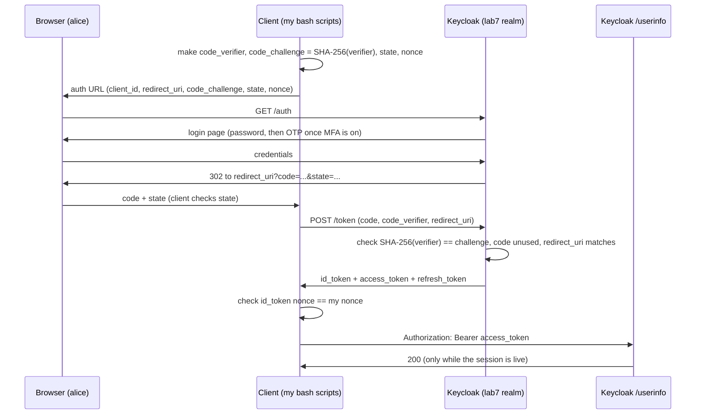

# Lab 7: OAuth 2.0, OpenID Connect, PKCE and MFA

**Date:** 18–20 November 2026
**Identity provider:** Keycloak 26 (`start-dev`) in Docker, bound to `127.0.0.1:8080`
**Realm:** `lab7` · **Client:** `lab7-app` (public, no client secret, standard flow only, PKCE `S256` enforced)
**Redirect URI:** exactly `http://localhost:8000/callback` (no wildcards)
**Test user:** `alice` (test account only)

No tokens, codes, verifiers or passwords are kept in this repo. The evidence files hold status codes and claim names only.

## What I built

I ran the authorisation-code flow with PKCE by hand from bash, without a library, so I could see every step.

Scripts: `lab7-start.sh` (builds the auth URL), `lab7-exchange.sh` (swaps the code and prints claim names), `lab7b.sh` (attacker helpers `steal`, `userinfo`, `refresh`).

## Part A: the flow and the attacks on it

| Test | Expected | Result |
|---|---|---|
| Code exchange with the right verifier | 200 | **200**, state ok, nonce matches |
| Replay the same code | rejected | **400** `invalid_grant` "Code not valid" |
| Fresh code, wrong verifier | rejected | **400** "PKCE verification failed: Code mismatch" |
| Auth request with `redirect_uri=http://localhost:9999/steal` | refused | Keycloak page: **"Invalid parameter: redirect_uri"**, no code issued |

### ID token vs access token (from my own decoded claims)

| Token | `typ` | `aud` | `azp` | nonce |
|---|---|---|---|---|
| ID token | `ID` | `lab7-app` | `lab7-app` | yes, matched mine |
| Access token | `Bearer` | `account` | `lab7-app` | no |

The ID token is addressed to my app (`aud=lab7-app`). It tells the app who logged in. The access token is addressed to an API (`aud=account`, Keycloak's account service). The app should never send the ID token to an API, and it should never read the access token to decide who the user is.

### My answers (Part A)

1. **What PKCE stops that state doesn't.** PKCE stops an attacker from swapping a stolen authorisation code for tokens without the original code verifier. `state` is checked by my app. PKCE is checked by Keycloak at the token endpoint, which is why a public client with no secret needs it.
2. **Which token is for what.** The ID token tells my app who logged in (`typ=ID`, `aud=lab7-app`). The access token is for calling an API (`typ=Bearer`, `aud` = the API, here `account`).
3. **Exact redirect URIs.** They make sure codes are only sent to trusted URLs. With a loose wildcard, an attacker could get codes or tokens redirected to their own site. My `9999/steal` test showed the exact match blocking that.
4. **State and nonce.** `state` stops login CSRF, where an attacker slips their own code into my callback. `nonce` ties the ID token to this one login request, so an old or injected ID token is rejected.
5. **OAuth vs OIDC.** OpenID Connect is "log in" (authentication, and it adds the ID token). OAuth 2.0 on its own is "let this app act for me" (delegated authorisation with access tokens).

## Part B: MFA does not save a token that was already stolen

| Step | refresh (stolen refresh token) | userinfo (stolen access token) |
|---|---|---|
| Stolen before MFA | not recorded (first attempt used a spent code) | not recorded |
| After enabling OTP for alice (her next login asked for an OTP) | **200** new tokens issued | **200** |
| After signing out all of alice's sessions in Keycloak | **400** "Session not active" | **401** |

Turning on MFA changed nothing for the attacker. Their tokens kept working until the session was killed on the server.

### My answers (Part B)

1. **Why MFA didn't stop the stolen tokens.** MFA protects the login process, not tokens that have already been issued and stolen.
2. **What stopped them.** Ending alice's session on Keycloak. Every token tied to that session died with it. The stolen access token's signature was still valid. It failed because `/userinfo` checks with Keycloak that the session is live. An API that only checks the JWT signature would keep accepting it until `exp`, which is the same lesson as Lab 5.
3. **Incident response for a stolen token.**
   - Revoke the stolen tokens and active sessions.
   - Force the user to log in again.
   - Check the logs to find any unauthorised access.
   - Reset credentials if needed.
   - Rotate the signing keys if they were exposed.
   - Check for persistence or further compromise.
4. **The moment MFA protects.** The login moment, when the user authenticates. It does not protect tokens that were already issued, active sessions or a compromised device.
5. **Link to Lab 6.** Both are about compromised tokens and revoking sessions. The difference is that refresh-token reuse detection in Lab 6 kills the session automatically when a stolen refresh token clashes with the real user's, and it invalidates the whole token family. MFA detects nothing, and here I had to sign the session out by hand.

## Remaining risks and production notes

- Keycloak 26 does not rotate refresh tokens by default here, so a stolen refresh token can be reused until the session ends. In production, turn on refresh token revocation, which is Keycloak's version of my Lab 6 reuse detection.
- Resource servers that validate JWTs offline should keep access tokens short, or use token introspection for sensitive actions.
- `start-dev`, HTTP and an embedded database are for the lab only. In production you need TLS, a real database, an admin account that isn't the bootstrap one, and the console not exposed.
- OTP can still be phished in real time. Phishing-resistant MFA (WebAuthn or passkeys) is stronger.

**OWASP:** A07:2021 Identification and Authentication Failures. A01:2021 Broken Access Control (open redirects and loose redirect URIs).
